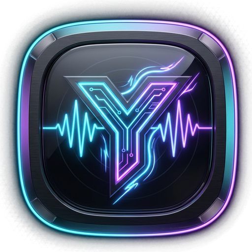

<p align="center">
  
</p>

<h1 align="center">LenovoMotorolovichY70 v3.0</h1>

<p align="center">
  <a href="https://github.com/f1rzen-n"></a>
  <a href="#"></a>
  <a href="#"></a>
  <a href="#"></a>
  <a href="#"></a>
  <a href="#"></a>
  <a href="#"></a>
  <a href="#"></a>
  <a href="https://4pda.to/forum/index.php?showtopic=1121132"></a>
</p>

<p align="center">
  Набор системных твиков и утилит для смартфонов <b>Lenovo Legion Y70</b> и <b>Motorola Edge 70 Max</b> (Android 12+).<br>
  Работает через <b>Shizuku</b> (без Root) или с правами <b>Root</b> (Magisk / KernelSU / APatch). Без рекламы и аналитики.
</p>

---

## Что нового в версии 3.0 (Мажорное обновление)

1. **Умное затухание Always On Display (AOD Smart Fade):**
   * Автоматическое мягкое отключение AOD через настраиваемый интервал после блокировки устройства (**5, 10, 15, 30 или 60 секунд**).
   * Защищает OLED-экран от локального выгорания пикселей и экономит 15–20% заряда аккумулятора.
   * Мгновенно восстанавливает включение AOD при пробуждении экрана.
   * Опциональный переключатель «Не гасить AOD при зарядке».
   * Автозапуск фоновой службы при старте системы (`BootReceiver`).

2. **100% прозрачный фон скорости сети в статус-баре:**
   * Фоновая плашка индикатора переведена в абсолютную прозрачность (`Color.TRANSPARENT`).
   * Текст с динамической тенью сохраняет идеальную читаемость на любых светлых приложениях, сайтах и светлых обоях.

3. **Интеллектуальный тайл разрешения в шторке (QS Tile):**
   * Динамическая векторная иконка тайла отображает текущий активный профиль: `QHD`, `FHD` или `HD`.
   * Полный 3-ступенчатый цикл переключения (QHD+ → FHD+ → HD+ → QHD+).
   * Устранено подзалипание шторки при смене геометрии экрана за счет мягкого сворачивания SystemUI.

4. **Модульная архитектура интерфейса v3.0 (Центр настроек):**
   * **Разгрузка главного экрана:** вместо монолитной структуры — чистый и быстрый диспетчер настроек в системном стиле Android / Moto Settings.
   * **Список 9 специализированных разделов:** каждый функциональный модуль (Экран, DC Dimming, AOD, Сенсор 1500 Гц, Bypass, Сеть, Звук, Debloater, NFC) вынесен в отдельный экран с навигацией и кнопкой «← Назад».
   * **Сводка системы (HUD):** компактный дашборд реального времени вверху экрана с ключевыми метриками (разрешение, DPI, герцовка, статус Shizuku/Root, AOD, DC Dimming, Bypass, NFC).
   * **Отцентрированный островок статуса прав:** автоматически определяет Root / Shizuku прямо под версией приложения.
   * **Векторные SVG-иконки** в едином дизайне для всех категорий.

---

## Возможности

### 1. Дисплей и DPI
* **Разрешение:** переключение между QHD+ (1440p), FHD+ (1080p) и HD+ (720p).
* **Плотность (DPI):** ручная регулировка ползунком или готовые пресеты под каждое разрешение.
* **Частота обновления:** фиксация 144 / 120 / 90 / 60 Гц или авто.
* **Защита от сбоев:** автоматический откат разрешения через 15 секунд при отсутствии подтверждения.
* **Плитки шторки:** динамические тайлы переключения герцовки и разрешения из быстрых настроек.

### 2. Умное затухание Always On Display
* Настраиваемый таймер гашения AOD (5с / 10с / 15с / 30с / 60с).
* Плавное отключение контроллера doze без мерцания.
* Возможность сохранения постоянного AOD во время зарядки устройства.

### 3. Отклик сенсора и анимации
* Регулировка скорости указателя (`pointer_speed`) для уменьшения задержки реакции на касания.
* Переключение скорости системных анимаций (0.5x / 1.0x).

### 4. Экран и защита глаз
* **DC Dimming:** переключение аппаратного режима без мерцания через узел драйвера панели (`/sys/class/drm/card0-DSI-1/panelDC`).
* **Анти-шлейф OLED (Black Floor Lift):** программное смещение чисто чёрного (`#000000 → #040404`), предотвращающее отключение субпикселей и смазывание текста при прокрутке на низкой яркости.
* Быстрый доступ к ночному свету и режиму Extra Dim.

### 5. Звук
* Отключение абсолютной громкости Bluetooth (`Disable Absolute Volume`) при тихом звуке в беспроводных наушниках.
* Отключение системного предупреждения о небезопасной громкости (`Safe Media Bypass`).
* Быстрый вызов Motorola Multi-Volume и Dolby Atmos.

### 6. Питание и зарядка
* Переключение контроллера питания в режим обхода батареи (Bypass Charging) через системные ноды PMIC (если поддерживается сборкой ядра).
* Отображение температуры аккумулятора и источника питания.

### 7. Скорость сети в статус-баре
* Компактный индикатор скорости (приём / отдача) справа у батареи со 100% прозрачным фоном.
* Автоматическая центровка и адаптация под текущее разрешение и DPI.
* Остановка таймера опроса при выключении экрана для экономии заряда.

### 8. Отключение приложений (Debloater)
* Отключение предустановленных пакетов по сценариям: «Минимальный», «Баланс», «Чистый», «Авторский».
* Изоляция приложений через AppOps без Root.
* Возможность восстановления всех пакетов в один клик.

### 9. Фикс NFC
* Графический интерфейс для переключения маршрутов NFC на процессор хоста (DH 0x00).
* Интегрирован алгоритм фикса маршрутов NFC (решение и инструкция от [stepchansky на 4PDA](https://4pda.to/forum/index.php?showtopic=1121132&view=findpost&p=146040708)).
* Поддержка экспорта готового архива для Magisk / KernelSU / APatch и возврат к стоковым маршрутам.

---

## Ссылки на 4PDA
* **Основная тема устройства:** [Lenovo Legion Y70 — Прошивки на 4PDA](https://4pda.to/forum/index.php?showtopic=1121132)
* **Пост автора и разработчика приложения:** [nik.reneyj (Пост #145909028)](https://4pda.to/forum/index.php?showtopic=1121132&view=findpost&p=145909028)
* **Пост автора алгоритма фикса NFC:** [stepchansky (Пост #146040708)](https://4pda.to/forum/index.php?showtopic=1121132&view=findpost&p=146040708)

---

## Сборка

Проект компилируется автономным скриптом на Python (требуется установленный JDK 17+):

```bash
python build_apk.py
```

Готовый файл: `LenovoMotorolovichY70_v3.0.apk`.

---

## Требования
* Смартфон: Lenovo Legion Y70 или Motorola Edge 70 Max.
* Доступ: Shizuku (через беспроводную отладку) или Root.

---

## Автор
* **Разработчик:** **nik.reneyj** ([GitHub: @f1rzen-n](https://github.com/f1rzen-n) | [4PDA: nik.reneyj](https://4pda.to/forum/index.php?showtopic=1121132&view=findpost&p=145909028))

---

## Лицензия и отказ от ответственности

### Условия использования (MIT License)
**Copyright (c) 2026 nik.reneyj ([@f1rzen-n](https://github.com/f1rzen-n))**

Исходный код приложения распространяется под свободной лицензией **MIT**. Разрешается свободное использование, изучение, модификация, распространение и создание форков как для личных, так и для открытых проектов при обязательном сохранении упоминания оригинального автора (**nik.reneyj**) и ссылки на репозиторий.
